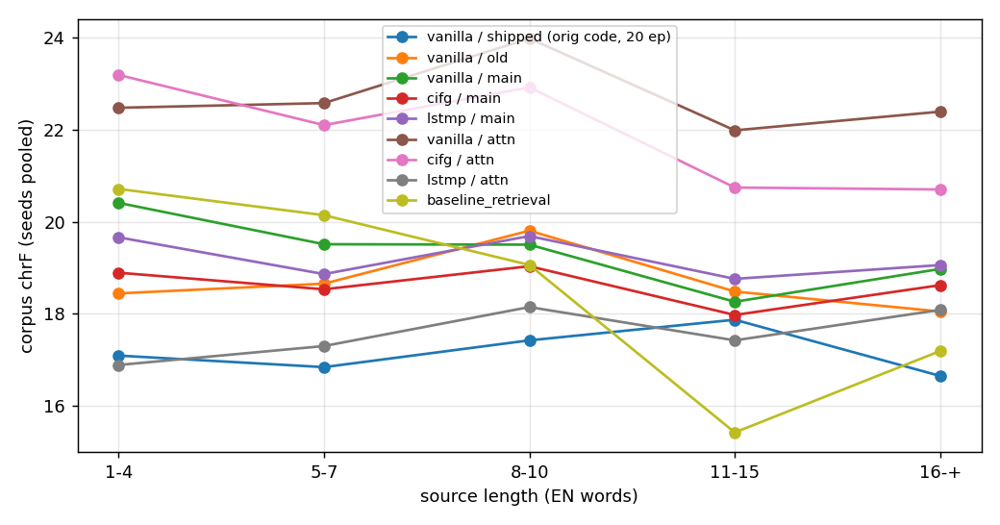
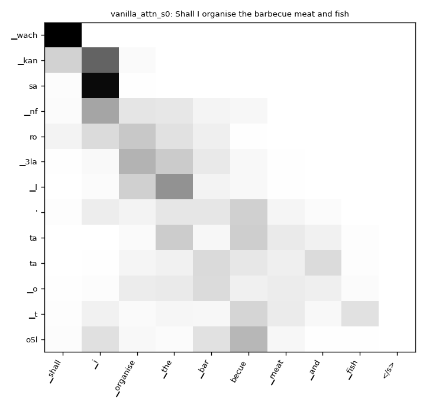
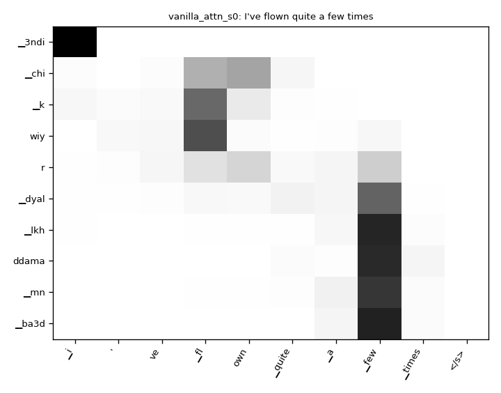
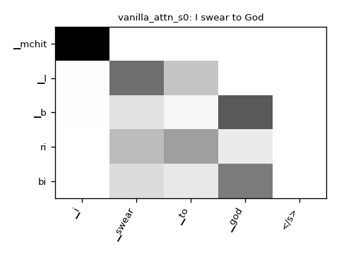
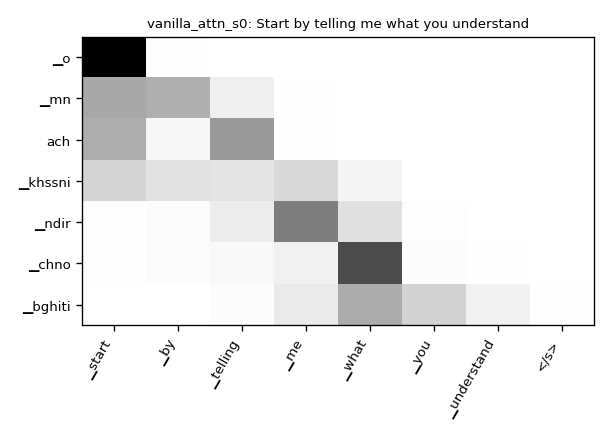

# Extra analyses

Test set: 1268 sentences. Seeds: mean ± std. Word-level numbers use whitespace tokens, case-sensitive.
A "digit-word" is a word containing both a digit and a Latin letter (Arabizi: 3=ع, 7=ح, 9=ق, ...); they are
29.5% of reference words.

## 1. Tokenizers on the test references
| tokenizer | dir | pieces | DAR tok/word | digit-only pieces | digit-words kept whole | pieces per digit-word | examples |
|---|---|---|---|---|---|---|---|
| original (split_by_number=True) | data/tok_orig | 3000 | 2.10 | 14.7% | 0.0% | 3.12 | ▁3/la ▁ch/7/al ▁t/7/k/em ▁nt/9/ad/ou |
| fixed (split_by_number=False) | data | 3000 | 1.85 | 2.8% | 40.5% | 2.12 | ▁3la ▁ch7al ▁t7/k/em ▁nt/9ad/ou |
| fixed + 75k monolingual Darija | data/tok_mono | 3000 | 1.98 | 3.2% | 29.3% | 2.36 | ▁3la ▁ch7al ▁t7/kem ▁nt/9a/dou |

## 2. Word-level diagnostics (greedy)
Digit-word recall = clipped matches of reference digit-words / all reference digit-words: the error the
tokenizer fix targets. A model that cannot emit digit-words scores ~0 here whatever its chrF.
| system | seeds | digit-word recall % | digit-words in output % | word recall % | word precision % | outputs with repeated word % | distinct-1 % | distinct-2 % | avg words |
|---|---|---|---|---|---|---|---|---|---|
| vanilla / shipped (orig code, 20 ep) | 1 | 6.1 | 50.7 | 11.9 | 13.2 | 4.7 | 16.7 | 45.0 | 3.9 |
| cifg / shipped (orig code, 20 ep) | 1 | 6.0 | 52.1 | 12.0 | 11.8 | 2.8 | 12.3 | 33.2 | 4.4 |
| lstmp / shipped (orig code, 20 ep) | 1 | 6.7 | 54.3 | 12.7 | 13.4 | 2.7 | 16.2 | 46.0 | 4.1 |
| vanilla / old | 3 | 7.8 ± 0.7 | 48.7 ± 0.7 | 13.6 ± 0.4 | 13.7 ± 0.4 | 3.0 ± 0.7 | 20.5 ± 0.8 | 52.3 ± 2.0 | 4.3 ± 0.0 |
| vanilla / tok | 3 | 8.0 ± 0.5 | 25.8 ± 1.0 | 15.3 ± 0.5 | 15.1 ± 0.6 | 4.8 ± 0.7 | 30.6 ± 0.6 | 64.5 ± 0.8 | 4.4 ± 0.0 |
| vanilla / mask | 3 | 8.0 ± 0.3 | 50.5 ± 0.7 | 13.5 ± 0.2 | 13.5 ± 0.1 | 4.4 ± 0.5 | 21.0 ± 1.4 | 53.5 ± 1.5 | 4.3 ± 0.0 |
| vanilla / main | 3 | 7.4 ± 0.2 | 25.4 ± 0.6 | 15.0 ± 0.3 | 15.1 ± 0.3 | 4.4 ± 0.7 | 31.7 ± 0.9 | 65.2 ± 1.8 | 4.3 ± 0.0 |
| vanilla / nosrc | 3 | 0.0 ± 0.0 | 0.0 ± 0.0 | 2.3 ± 0.0 | 3.3 ± 0.0 | 0.0 ± 0.0 | 0.1 ± 0.0 | 0.1 ± 0.0 | 3.0 ± 0.0 |
| cifg / main | 3 | 7.2 ± 0.6 | 25.4 ± 1.0 | 14.0 ± 0.5 | 14.7 ± 0.4 | 2.9 ± 0.6 | 30.0 ± 0.8 | 61.0 ± 1.4 | 4.1 ± 0.1 |
| lstmp / main | 3 | 7.6 ± 0.3 | 25.9 ± 0.8 | 14.5 ± 0.4 | 14.3 ± 0.4 | 3.7 ± 0.7 | 30.3 ± 0.6 | 62.4 ± 1.3 | 4.4 ± 0.0 |
| vanilla / attn | 3 | 10.5 ± 0.3 | 25.3 ± 0.3 | 18.9 ± 0.4 | 17.7 ± 0.4 | 5.7 ± 1.0 | 36.6 ± 1.0 | 76.1 ± 1.6 | 4.6 ± 0.0 |
| cifg / attn | 3 | 10.7 ± 0.2 | 25.0 ± 0.9 | 18.2 ± 0.5 | 17.4 ± 0.1 | 4.7 ± 0.8 | 35.8 ± 1.0 | 73.6 ± 0.7 | 4.5 ± 0.1 |
| lstmp / attn | 3 | 5.8 ± 0.4 | 23.8 ± 0.7 | 12.6 ± 0.4 | 11.8 ± 0.5 | 3.5 ± 0.4 | 23.1 ± 1.7 | 52.1 ± 2.9 | 4.6 ± 0.1 |
| baseline_retrieval | 1 | 8.2 | 28.6 | 12.6 | 15.4 | 0.1 | 46.0 | 78.4 | 3.5 |
| baseline_mostfreq | 1 | 0.0 | 0.0 | 0.1 | 0.2 | 0.0 | 0.1 | 0.0 | 1.0 |
| reference (upper bound for word stats) | 1 | 100.0 | 29.5 | 100.0 | 100.0 | 0.2 | 54.9 | 95.7 | 4.3 |

## 3. chrF by source length (greedy, seeds pooled)

| system | seeds | EN 1-4 w (n=520) | EN 5-7 w (n=448) | EN 8-10 w (n=165) | EN 11-15 w (n=103) | EN 16-+ w (n=32) |
|---|---|---|---|---|---|---|
| vanilla / shipped (orig code, 20 ep) | 1 | 17.09 | 16.84 | 17.43 | 17.87 | 16.65 |
| vanilla / old | 3 | 18.44 | 18.66 | 19.80 | 18.48 | 18.05 |
| vanilla / main | 3 | 20.41 | 19.51 | 19.50 | 18.26 | 18.97 |
| cifg / main | 3 | 18.89 | 18.53 | 19.03 | 17.98 | 18.62 |
| lstmp / main | 3 | 19.66 | 18.86 | 19.69 | 18.76 | 19.06 |
| vanilla / attn | 3 | 22.47 | 22.57 | 23.97 | 21.98 | 22.39 |
| cifg / attn | 3 | 23.18 | 22.09 | 22.91 | 20.74 | 20.70 |
| lstmp / attn | 3 | 16.89 | 17.30 | 18.15 | 17.43 | 18.09 |
| baseline_retrieval | 1 | 20.71 | 20.14 | 19.06 | 15.43 | 17.19 |

## 4. Beam length-penalty sweep (alpha)
alpha=0.6 is the grid setting; larger alpha penalises short outputs less.
| run | beam | alpha | chrF | BLEU | len ratio | empty |
|---|---|---|---|---|---|---|

## 5. Attention (vanilla / attn, seed 0)
Rows = generated target pieces, columns = source pieces in reading order (the encoder reads them reversed).

## 6. Examples (fixed random sample, numpy seed 7)
**#34** EN: Shall I organise the barbecue meat and fish  
GOLD: `wach ndir chwa dyal l7am o l7ot`  
vanilla / shipped (orig code, 20 ep) (seed 0): `wach n9dar n3ich f l7afla`  
vanilla / old (seed 0): `wach n9der n3ich f l7amam`  
vanilla / main (seed 0): `o ana kanl3b l karTa dyal limon`  
vanilla / attn (seed 0): `wach kansa nfro 3la l'tata o toSl`  
baseline_retrieval (seed 0): `kan9tar7 l7ot o bTaTa`  

**#98** EN: I've flown quite a few times  
GOLD: `safrt bzaf dyal lmrat`  
vanilla / shipped (orig code, 20 ep) (seed 0): `ana kan7as b7al b7al hada`  
vanilla / old (seed 0): `3ndi ch7al dyal lwe9t dyal lma`  
vanilla / main (seed 0): `sme3t sme3t chwiya dyal lmasa`  
vanilla / attn (seed 0): `3ndi chi kwiyr dyal lkhddama mn ba3d`  
baseline_retrieval (seed 0): `chi marart mrat bzaf fsimana`  

**#110** EN: I swear to God  
GOLD: `kan7lef lik`  
vanilla / shipped (orig code, 20 ep) (seed 0): `kan9sad nt3ellem`  
vanilla / old (seed 0): `3ndi l7ot`  
vanilla / main (seed 0): `kansme3 li8`  
vanilla / attn (seed 0): `mchit l bribi`  
baseline_retrieval (seed 0): `7lef blla8`  

**#284** EN: Start by telling me what you understand  
GOLD: `bda b annak tgoliha chno katfham`  
vanilla / shipped (orig code, 20 ep) (seed 0): `3afak mat9t bach t9der t3awed`  
vanilla / old (seed 0): `3afak matgolch lia 3la chno kat3awd?`  
vanilla / main (seed 0): `ach kat3awd lik`  
vanilla / attn (seed 0): `o mnach khssni ndir chno bghiti`  
baseline_retrieval (seed 0): `ach kat9sad b toppings`  

**#445** EN: I don't have toys  
GOLD: `ma3ndich llo3ab`  
vanilla / shipped (orig code, 20 ep) (seed 0): `ma3ndich l7wayj`  
vanilla / old (seed 0): `ma3ndich l7wayj`  
vanilla / main (seed 0): `ma3ndich 7ta 7aja`  
vanilla / attn (seed 0): `ma3ndich ljerta7`  
baseline_retrieval (seed 0): `ma3endich lflous`  

**#457** EN: he is only about 180cm tall  
GOLD: `fih 5ir chi mitrou ou tmanin santim`  
vanilla / shipped (orig code, 20 ep) (seed 0): `howwa 3la 9bel dyal l7ayawanat`  
vanilla / old (seed 0): `howwa 3la 9bel l9ahwa`  
vanilla / main (seed 0): `kayl3b m3a had l as2ila`  
vanilla / attn (seed 0): `kayl3eb ssebt douz`  
baseline_retrieval (seed 0): `8owwa Twil`  

**#492** EN: Oh, yeah, I saw about the glasses  
GOLD: `oh, ah rah chaft nDaDr`  
vanilla / shipped (orig code, 20 ep) (seed 0): `oh, ah, 3arf`  
vanilla / old (seed 0): `Oh, ah, 3la 7sab l3am jjay`  
vanilla / main (seed 0): `oh, ah, ana bikhir`  
vanilla / attn (seed 0): `oh, ah, ana fari9 f jjame3`  
baseline_retrieval (seed 0): `cheft nnatija`  

**#546** EN: or we can also invite the nurse that I ran into when I came in  
GOLD: `o imkn lina tta n3ardo 3la lfrmlia li tsat7t m3aha mli knt jay"`  
vanilla / shipped (orig code, 20 ep) (seed 0): `imkn n9dro ndiro chi 7aja khra bach n3tiw l7al, o kan9dar t3awni`  
vanilla / old (seed 0): `momkin n9dro n3awnna 3la 7sab chi 7aja m3a chwiya dyal l7amam`  
vanilla / main (seed 0): `ola imken lina ndwiw 3la l passuceporat dial l5asm kan s7i7`  
vanilla / attn (seed 0): `ola imkan lina nakhdo chi 7aja bach n7tajolo l ananan mli kankoun f ddar`  
baseline_retrieval (seed 0): `ahlan, ana 7san mli kantl3o f l8awa2`  

**#587** EN: You know, it's only 8 on Tuesday  
GOLD: `kif kat3raf, hir 8 safi nhar tlat`  
vanilla / shipped (orig code, 20 ep) (seed 0): `3rfti, rah kat3raf bzaf`  
vanilla / old (seed 0): `3rfti, rah 3arf bzaf dyal l7wayj`  
vanilla / main (seed 0): `nta, rak 3arf f had llila`  
vanilla / attn (seed 0): `3rfti kat3raf, rah Tabi3i o rah kayDa3`  
baseline_retrieval (seed 0): `3la 7sabk`  

**#621** EN: I believe you.  
GOLD: `tyye9tek.`  
vanilla / shipped (orig code, 20 ep) (seed 0): `ana.`  
vanilla / old (seed 0): `kan7essek.`  
vanilla / main (seed 0): `ana bikhir.`  
vanilla / attn (seed 0): `ana kan7tarmek.`  
baseline_retrieval (seed 0): `kanti9 fik.`  

**#769** EN: enjoy life  
GOLD: `tmata3 bl7yat`  
vanilla / shipped (orig code, 20 ep) (seed 0): `l9ahwa`  
vanilla / old (seed 0): `l7lib`  
vanilla / main (seed 0): `tbers`  
vanilla / attn (seed 0): `sta3ed douz`  
baseline_retrieval (seed 0): `hadi hia l7ayat`  

**#903** EN: We'll think about it tomorrow.  
GOLD: `daba nfkkro fhadchi ghdda.`  
vanilla / shipped (orig code, 20 ep) (seed 0): `ghadi nkono 3la l7al.`  
vanilla / old (seed 0): `ghadi ndiro 7aja khra.`  
vanilla / main (seed 0): `ghadi ndiro chi 7aja.`  
vanilla / attn (seed 0): `ghadi ndiro9aw ghda`  
baseline_retrieval (seed 0): `7sn lia manfkkerch fiha`  

**#1118** EN: We'll see about that!  
GOLD: `daba nchoufou m3a hadchi!`  
vanilla / shipped (orig code, 20 ep) (seed 0): `ghadi nkono 7ta 7aja`  
vanilla / old (seed 0): `daba nchofo!`  
vanilla / main (seed 0): `ghadi ndiro 3otla!`  
vanilla / attn (seed 0): `ghadi nakhd nfekklo hadchi`  
baseline_retrieval (seed 0): `daba nchofo`  

**#1150** EN: the meeting has been cancelled  
GOLD: `l2ijtima3 ttelgha`  
vanilla / shipped (orig code, 20 ep) (seed 0): `l2a5ani kay3jbouni l7wayj`  
vanilla / old (seed 0): `l7iT dial l5asm`  
vanilla / main (seed 0): `l pizza kan m3etel`  
vanilla / attn (seed 0): `ttran m3eTTelna larbe3`  
baseline_retrieval (seed 0): `chkon lli m3rouD?`  

**#1211** EN: Yeah.  
GOLD: `ah`  
vanilla / shipped (orig code, 20 ep) (seed 0): `ah,.`  
vanilla / old (seed 0): `ah.`  
vanilla / main (seed 0): `ah.`  
vanilla / attn (seed 0): `ah.`  
baseline_retrieval (seed 0): `ach kat9sad b toppings`  

