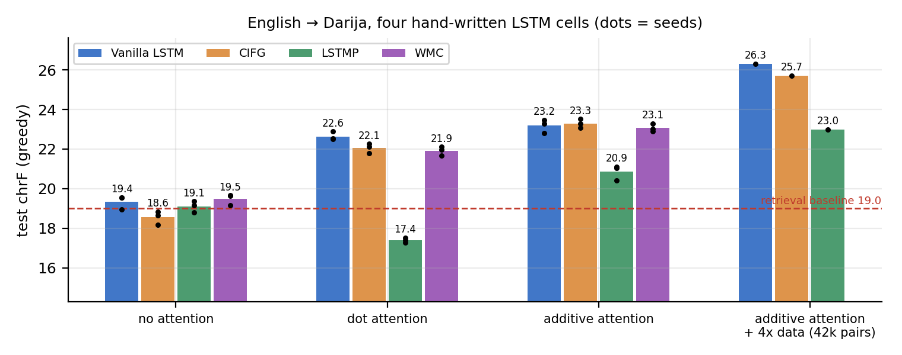

# English → Moroccan Darija translation with hand-written LSTM cells

Four recurrent cells — **vanilla LSTM, CIFG, LSTMP and WMC** — implemented from their equations with `nn.Linear`
(no `nn.LSTM`), compared in the same encoder-decoder on English → Darija (Latin script, "Arabizi") translation,
with 3 seeds per setting, paired-bootstrap significance tests and honest baselines.



> **Status (26 Oct 2026):** the 10k-pair study is complete; the 42k-pair runs are in progress (seed 0 shown below).
> See [`CONTINUE.md`](CONTINUE.md) for what is left and how to run it.

## Key findings

1. **The tokenizer was splitting Darija words at every digit.** In Arabizi, digits are letters (3 = ع, 7 = ح,
   9 = ق), but SentencePiece's default `split_by_number=True` cut `3la` into `▁3 / la` and `ch7al` into
   `▁ch / 7 / al`. Fixing it is worth **+0.9 chrF** (p = 0.001, 3 seeds). Details: [`docs/bug_hunt.md`](docs/bug_hunt.md).
2. **Without attention, cell choice barely matters and nothing beats a retrieval baseline.** Vanilla, LSTMP and WMC
   are within 0.4 chrF of each other (19.1–19.5); CIFG is significantly lower (−0.8, all seeds). A nearest-neighbour "copy the closest
   training sentence" baseline scores 19.0.
3. **Dot-product attention breaks LSTMP.** Its projected outputs are not tanh-squashed, so the dot-product scores
   saturate: 95% of the attention lands on a single source word (normalised entropy 0.07 vs 0.40 for the vanilla
   cell) and LSTMP gets *worse* with attention (19.1 → 17.4). Scaling the scores by 1/√d over-corrects (attention
   becomes almost uniform); **additive attention**, which learns its own scale, fixes it (17.4 → 20.9).
4. **With additive attention the vanilla, CIFG and WMC cells are statistically tied** (23.1–23.3 chrF); LSTMP stays
   ~2.3 points behind with 25% fewer parameters.
5. **Data matters more than the cell.** Adding 31.6k leakage-filtered pairs from the Darija Open Dataset (and a 6k BPE
   chosen on validation) raises the vanilla model from 23.2 to **26.3 chrF** (seed 0), while a retrieval baseline over the same larger corpus does *not* improve
   (19.0 → 18.5): the gain is learning, not leakage.

## Results

Test set: 1,268 sentences, greedy decoding, corpus chrF (sacreBLEU); mean ± std over 3 seeds.

| system | Vanilla | CIFG | LSTMP | WMC |
|---|---|---|---|---|
| original course model (1 seed) | 17.10 | 17.13 | 17.45 | – |
| no attention | 19.35 ± 0.34 | 18.56 ± 0.34 | 19.11 ± 0.28 | 19.48 ± 0.28 |
| dot attention | 22.64 ± 0.22 | 22.06 ± 0.24 | 17.40 ± 0.12 | 21.92 ± 0.23 |
| general (bilinear) attention | 22.98 ± 0.80 | 22.89 ± 0.48 | 18.13 ± 1.47 | 21.20 ± 1.99 |
| additive attention | 23.18 ± 0.34 | **23.30 ± 0.22** | 20.86 ± 0.38 | 23.07 ± 0.20 |
| additive attention, 42k pairs (seed 0) | **26.31** | 25.71 | 23.00 | – |
| *parameters (no attention, 3k BPE)* | 2,327,480 | 2,130,360 | 1,747,128 | 2,720,696 |

Reference points: retrieval baseline 19.01 · most frequent sentence 4.58 · decoder without the source 7.85 ·
small Transformer (7.8M parameters, 10k pairs, seed 0) 18.21.
Everything else — ablation of each pipeline fix, the hyperparameter study, significance tests, attention statistics,
the tokenizer study — is in [`RESULTS.md`](RESULTS.md); word-level diagnostics and examples in [`EXTRAS.md`](EXTRAS.md).

## Quick start

```bash
pip install torch --index-url https://download.pytorch.org/whl/cu126     # or .../whl/cpu
pip install -e ".[dev,docs,app]"
pytest -q                                                       # cells == appendix equations, masking, decoding, ...
python -m darija_nmt.translate "where are you going?" --run vanilla_c42_s0       # -> fin ghatmchi?
python app/app.py                                               # Gradio demo with an attention heatmap
```

Rebuild the data from Hugging Face (sha256-checked) and rerun the study:

```bash
python scripts/prepare_data.py          # the splits used everywhere (the CSVs are not redistributed)
python scripts/build_extra_data.py      # + leakage-filtered DODa pairs for the 42k experiments
python scripts/run_experiments.py --only main,attn,attn_additive --jobs 2     # resumable experiment grid
python scripts/analyze.py && python scripts/figures.py
```

## What is inside

| path | content |
|---|---|
| `src/darija_nmt/cells.py` | Vanilla LSTM, CIFG, LSTMP, WMC — appendix equations, two fused `nn.Linear` per cell |
| `src/darija_nmt/models.py` | masked encoder (optionally bidirectional), decoder with dot / general / additive attention |
| `src/darija_nmt/train.py`, `evaluate.py` | training with early stopping; greedy and beam decoding; chrF, chrF++, BLEU |
| `src/darija_nmt/transformer.py` | small Transformer baseline with the same interface |
| `scripts/` | experiment grid and scheduler, analysis, figures, data preparation, back-translation, human evaluation |
| `tests/` | 31 checks: each cell equals the appendix written gate by gate, padding invariance, decoding, leakage |
| `docs/` | [bug hunt](docs/bug_hunt.md), [data card](docs/data_card.md) |
| `app/` | Gradio demo (local or Hugging Face Space) |

## Data and licences

Code: MIT. Data is **not** redistributed: `imomayiz/darija-english` (licence "cc", version unspecified) and
`atlasia/darija_english` (CC BY-NC 4.0, extra-data experiments only) are downloaded and filtered by the scripts.
Models trained on the extra data inherit its non-commercial licence. See [`docs/data_card.md`](docs/data_card.md).

## Limitations

10k short crowd-sourced pairs with one reference each: absolute scores are low and BLEU is 2–4 for every system, so
chrF is the main metric. 3.9% of test sentences equal a training sentence up to punctuation (inherited split; same
for all systems). The 42k results are single-seed so far.

## Credits

Course project for Advanced NLP (Université Internationale de Rabat, 2026–27), first developed by a student team.
Audit and extension after submission: Mohamed Nacir with Hamza Ziouine; developed with the help of an AI coding
assistant (Claude); every number in this repository comes from the logged runs in `results*.jsonl`.
